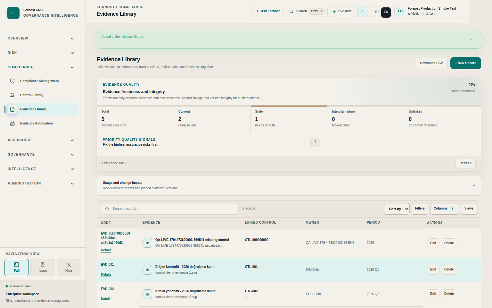

# Fornost GRC — canlı QA sonuçları, 12 Kasım 2026

**Sonuç:** Çalıştırılan temel kayıt işlemleri, bağlantı yönetimi, rapor indirmeleri ve yerel hesap yaşam döngüsü geçti. Kanıt Kütüphanesi'nde iki işlevsel bulgu ve bir kullanılabilirlik bulgusu doğrulandı. Tüm özelliklerin koşulsuz geçtiği veya ürünün hatasız olduğu sonucu çıkarılamaz.

## Ortam ve yöntem

- Canlı hedef: https://app.fornostsecurity.com/ — uygulama sürümü `12546543a45cc9f3c8b7bcca3b6351595de3e16b`.
- Gerçek Chromium tarayıcısı, GitHub Actions üzerinden canlı uygulamaya bağlandı. Formlar, görünür düğmeler ve indirmeler Playwright ile kullanıldı; API kontrolleri kalıcılık, yetki, referans bütünlüğü ve temizlik doğrulamasını tamamladı.
- Canlı görünüm kapsamı: 27 ana sayfa, Türkçe/açık tema/1536 px ve İngilizce/koyu tema/390 px; ayrıca 34 AI çalışma alanı ve 36 alt sekme ziyareti.
- Kapanış kontrolü 09:01:36 UTC / 12:01:36 Türkiye: üretim sürümü değişmemişti. Uygulama kodu değiştirilmedi, dağıtım yapılmadı. QA betikleri ve rapor ayrı dalda tutuldu.
- Yalnızca benzersiz `QA-LIVE-...` kayıtları oluşturuldu. Mevcut iş kayıtları değiştirilmedi. İş akışlarının kapsamlı yaşam döngüsü testleri, işletme kayıtları üzerinde onay/kapanış üretmemek için ayrı veritabanında çalıştırıldı.

## Doğrulanmış ürün bulguları

### F-01 — Silinen kanıt dosyası normal indirme uç noktasından erişilebilir kalıyor

**Öncelik: P2, işlevsel erişim/saklama tutarlılığı.**

1. Sentetik bir metin dosyası Kanıt Kütüphanesi'ne yüklendi.
2. Kanıt kaydı silindi; `/api/grc` sonucunda kaydın artık bulunmadığı doğrulandı.
3. Önceden bilinen dosya anahtarıyla `/api/evidence?key=...` çağrısı, aynı yetkili yönetici oturumunda tekrar yapıldı.
4. Yanıt **HTTP 200** oldu; içerik sentetik dosyayla birebir aynıydı.

**Etki:** Listeden silme, dosyaya normal erişimin kaldırılması anlamına gelmiyor. Test, anonim erişim veya başka kiracının verisine erişim göstermiyor. Denetim amacıyla saklama gerekebilir; ancak bu durumda açık arşiv/saklama davranışı ve ayrı erişim kontrolü gerekir.

**Düzeltme önerisi:** Silinmiş kayda ait dosyanın olağan indirme yolunu kapatmak; yasal/denetim saklamasını açık bir arşiv politikası ve yetkilendirilmiş erişimle yönetmek. Bağlı veya sabitlenmiş kanıt sürümlerini körlemesine fiziksel silmemek.

**Kod izi:** `app/api/evidence/route.ts` GET, anahtarla depolamadan okuyor; aktif kayıt/silinme durumunu kontrol etmiyor. `app/core-record-delete.ts` kayıt ve kod eşlemesini kaldırıyor; dosya/sürüm saklama davranışı ayrı kalıyor.

**Kanıt:** [Canlı retention testi](https://github.com/jacobevci-lab/Fornost-GRC/actions/runs/43187396747/job/131077898298), `live-all-qa-retention/report.json`. Bu test beklenen erişim engeli oluşmadığı için bilerek kırmızı sonuçlandı.

### F-02 — Var olmayan kanonik kontrol koduyla kanıt oluşturulabiliyor

**Öncelik: P2, veri ve bağlantı bütünlüğü.**

1. Kanıt ekleme formuna küçük bir `.txt` dosyası ve zorunlu alanlar girildi.
2. Bağlı kontrol alanına sistemde bulunmayan `CTL-999999999` yazıldı.
3. Kaydetme **HTTP 201** döndü; kayıt gerçekten oluştu ve listede bu kontrol koduyla gösterildi.

**Beklenti:** Kanonik bir kayıt kodu girildiğinde hedefin varlığı doğrulanmalı; kullanıcıya alan bazlı hata verilmeli. Harici/serbest metin referansı destekleniyorsa bu, mevcut kontrol bağlantısından açıkça ayrılmalı.

**Etki:** Kanıt–kontrol zincirinde çözümlenemeyen bağlantı oluşabiliyor. Aynı test paketinde risk için var olmayan varlık referansı doğru biçimde 422 ile reddedildi; yükleme yolu tutarsız.

**Kod izi:** `app/api/evidence/route.ts` POST alanı zorunlu tutuyor ve referans metnini kaydediyor; kanonik hedefin varlığını doğrulamıyor.

**Kanıt:** [Canlı supplement testi](https://github.com/jacobevci-lab/Fornost-GRC/actions/runs/43186631567/job/131075302821), `live-all-qa-supplement/report.json`, aşağıdaki ekran görüntüsü. Oluşturulan kayıt sonradan listeden temizlendi.

### F-03 — Yüklenen kanıtın görünen kodu uzun teknik UUID oluyor

**Öncelik: P3, kullanılabilirlik ve kayıt kodu tutarlılığı.**

Yeni dosya yüklemesi kısa bir `EVD-xxx` kodu yerine `EVD-<UUID>` gösteriyor. Kod hücrede birkaç satıra bölünüyor; arama, sözlü paylaşım ve kayıt karşılaştırmasını zorlaştırıyor. Aynı ekrandaki örnek kayıtlar kısa `EVD-001` biçiminde.

**Düzeltme önerisi:** Dahili UUID korunurken, yükleme işlemi diğer çekirdek kayıtlarla aynı kalıcı kullanıcı kodu tahsis mekanizmasını kullanmalı.

**Kod izi:** Yükleme rotası doğrudan `simple_grc_records` kaydı oluşturuyor; normal `/api/grc` oluşturma yolunun kısa kod tahsisini kullanmıyor.

## Sonuç sayıları ve kapsamın anlamı

| Paket | Sonuç | Açıklama |
|---|---:|---|
| Canlı sayfa/sekme gezinmesi | Geçti | 27 ana sayfa × 2 düzen, 34 AI alanı; ana gezinme raporu 81 test sarmalayıcısı içerir. Boş sekme sarmalayıcıları bağımsız özellik testi sayılmadı. |
| Canlı temel işlemler | 9/9 geçti | Beş çekirdek kayıtta gerçek form CRUD; kanıt yükleme/indirme/düzenleme/silme; API yarışma/referans kontrolleri; denetim oluşturma; AI taslak işlemleri. |
| Canlı bağlantı/rapor/ek sekmeler | 5 geçti, 1 bulgu | Risk–BIA bağlantısı/kaldırma/geçmiş; filtreli PDF/HTML/CSV/XLSX; regülasyon, KRI, kanıt otomasyonu alt görünümleri; F-02 başarısız negatif testi. |
| Canlı silinen dosyaya erişim | 1 bulgu | F-01; kayıt yokken dosya 200 ile döndü. |
| İzole yaşam döngüsü ve yetki paketi | 104/104 geçti | 36 işlevsel/altyapı senaryosu ve 68 AI ekran render kontrolü. 104 farklı iş özelliği anlamına gelmez. |
| Canlı yerel hesap yaşam döngüsü | Geçti | Aynı sürümdeki mevcut koşunun tamamlanan adımı kullanıldı; oluşturma, isim/rol/kapsam değişimi, oturum iptali, kapatma/açma, silme iptali, mobil silme, denetim izi, yeniden girişin engellenmesi. |

Çalıştırılan yeni canlı paketlerde yakalanan sayfa JavaScript hatası ve API 5xx sayısı **0**. Bu, tüm olası veri veya kullanım kombinasyonlarının hatasız olduğunu kanıtlamaz. Dosya içerik kontrolü indirme yanıtının baytlarını doğruladı; rapor indirmelerinde dosya türü/boyutu, filtre kapsamı ve HTML önizleme eşitliği kontrol edildi. PDF'nin bütün sayfalarının baskı düzeni incelenmedi.

## Modül bazında kapsam

Her satırdaki ana ekran canlıda açıldı. “İzole” ifadeleri aynı uygulama kodunun ayrı veritabanındaki testini belirtir; canlı iş akışı onayı olarak yorumlanmamalıdır.

| Modül | Canlıda doğrulanan ek işlemler | İzole veya sınırlı kapsam |
|---|---|---|
| Gösterge Paneli | Masaüstü/mobil görünüm | Denetim son tarihinin bugün/geçmiş/kapalı durum hesabı izole geçti. |
| Benim İşlerim | Masaüstü/mobil görünüm | Sahiplik, 80 üzeri sayfalama, bugün filtresi, CAPA geçişi izole geçti. |
| Risk Değerlendirmesi | Formla ekle/düzenle/yeniden aç/sil, varlığa bağla, bağlı varlığın silinmesini engelle | Eski sürümle yazma/silme 409; eksik varlık 422. |
| Varlık Envanteri | Formla ekle/düzenle/yeniden aç/sil | Bağlı kayıt korumaları ve rol sınırları izole de geçti. |
| İş Etki Analizi | Formla ekle/düzenle/yeniden aç/sil, RPO=0 korunması | Süreklilik planına bağlı BIA silme koruması izole geçti. |
| Tedarikçi Yönetimi | Dört alt sekme | Onboarding, değerlendirme, bağımsız onay ve offboarding izole geçti. |
| Risk İştahı ve KRI | Altı alt görünüm | Onay, ölçüm, eşik ihlali, aksiyon, bağımsız kapanış ve emeklilik izole geçti. |
| İş Sürekliliği ve Dayanıklılık | Plan/tatbikat/iyileştirme sekmeleri | Plan formu, inceleyen ayrılığı, tatbikat ihlali ve açığın kapatılması izole geçti. |
| Uyum Yönetimi | Formla ekle/düzenle/yeniden aç/sil | Rol sınırları izole geçti. |
| Kontrol Kütüphanesi | Formla ekle/düzenle/yeniden aç/sil | Rol ve referans kontrolleri izole geçti. |
| Kanıt Kütüphanesi | Dosya yükle, indir/bayt karşılaştır, düzenle, kaydı sil | F-01, F-02 ve F-03 açık. Kayıt silme ile dosya erişimini kaldırma ayrı sonuçlar. |
| Kanıt Otomasyonu | Kaynak/kontrol/geçmiş sekmeleri | Kaynak oluştur/düzenle, kural oluştur/devre dışı bırak, gizli değer maskeleme izole; gerçek sağlayıcı toplaması yapılmadı. |
| Denetim Yönetimi | Tarayıcıyla özel denetim oluştur; API ile sil ve yokluğunu doğrula | Canlı denetim silme düğmesi bu pakette kullanılmadı. Şablon, tekrar koruması, arşiv/silme ve gereksinim temizliği izole geçti. |
| Bulgular ve CAPA | Ana ekran | Oluştur/başlat/sun/bağımsız doğrula/yeniden aç izole geçti. |
| Güvenlik Olayları ve Kriz | Ana ekran | İlan, işlem adımları, bağımsız kapanış ve yeniden açma izole geçti. |
| Politika Merkezi | Beş alt sekme | Taslak/sürüm/bağımsız onay/yayın/emeklilik izole geçti. Word/PDF içe aktarma için mevcut çalışma alanı QA sonucu ek kanıt; canlı tekrar yapılmadı. |
| Regülasyon Merkezi | Dört alt görünüm | Kaynak/değişiklik/etki/aksiyon/bağımsız doğrulama/kapanış izole geçti. |
| AI Yönetişimi | 34 alan; taslak model API CRUD ve tarayıcı envanteri | Risk/rol sınırları ve 68 tema-render kontrolü izole; bütün AI alt alanlarının tüm mutasyonları veya dış model yanıtları test edilmedi. |
| Bağlantılı GRC Haritası | Risk–BIA bağla/kaldır, hedef kaydı koru, iki geçmiş olayı | Yedi çekirdek modülde doğru kaydı açma/bağlamsal filtre temizliği izole geçti. |
| Raporlama | Sentetik sahibi ve BIA kapsamıyla filtrele; HTML/PDF/CSV/XLSX indir | HTML önizleme eşitliği; PDF/XLSX imzası; sentetik CSV içeriği doğrulandı. |
| Ask Fornost | Ana ekran | Dış LLM yanıt üretimi, ücretli çağrı ve gerçek müşteri içeriğiyle deneme yapılmadı. |
| İş Akışı Entegrasyonları | Bağlantı/geçmiş/sürekli güvence sekmeleri | Sağlayıcı formları/sır sıfırlama/yerel doğrulamalar izole; Jira/ServiceNow/GitHub'a gerçek iş kaydı gönderilmedi. |
| Kimlik ve Erişim | Dört sekme ve canlı hesap yaşam döngüsü | Gerçek Entra/Okta/SAML/LDAP federasyonu ve kurum sağlayıcısında MFA akışı test edilmedi. |
| Sistem Ayarları | Ana ekran; dil/tema gerçek gezintide kullanıldı | Üretimde genel oturum veya güvenlik politikaları değiştirilmedi. |
| AI Ayarları | Ana ekran | Üretim sağlayıcı anahtarı veya model yapılandırması değiştirilmedi. |
| Ana Veri Yönetimi | Ana ekran | Ekle/tekrar doğrula/sil/rol sınırı izole geçti; canlı ortak kategoriler değiştirilmedi. |
| E-posta ve Bildirimler | Ana ekran | Gerçek SMTP/Graph teslimatı, davet ve zamanlanmış bildirim gönderimi doğrulanmadı. |

## QA altyapısı bulgusu ve sınırlar

Eski [Full Production QA koşusu](https://github.com/jacobevci-lab/Fornost-GRC/actions/runs/43181365630) yerel hesap yaşam döngüsü adımını geçti; ardından eski genel gezinti betiği görünür `EN` düğmesini beklerken 30 saniyelik zaman aşımına uğradı. Tekrar deneme sırasında iş toplam süre sınırında iptal edildi. **Bu iş yeşil değil; kalan adımlar tamamlanmış sayılmadı.** Yeni odaklı canlı paketler bağımsız sonuç verir. Eski testin yaşam döngüsü, hazır olma koşulu ve tekrar stratejisi düzeltilmeli; mevcut kanıt tek başına ürün dil değiştiricisinin bozuk olduğunu göstermiyor.

İlk yeni test denemelerinde de eski placeholder/kayıt seçicileri ve kapatılmış sayfaya bağlı locator hataları bulundu. İzole ortamda seed ve şifreleme anahtarı hazırlığı eksikti. QA hazırlığı/seçiciler düzeltildi, ilgili senaryolar tekrarlandı; bunlar ürün hatası sayılmadı. Geçmiş başarısız koşular GitHub'da korunuyor.

Safari/Firefox, gerçek fiziksel mobil cihaz, tam WCAG denetimi, yük/uzun süre testi, geniş dosya türü/fuzz matrisi, bütün rol×modül×eylem kombinasyonları, gerçek dış sağlayıcı teslimatı ve her AI alt iş akışının bütün geçişleri bu çalışmada tamamlanmadı. Dolayısıyla kapsam yüzdesi veya “eksiksiz hatasız” iddiası verilmedi.

## Temizlik ve önerilen sıra

Yeni canlı mutasyon paketlerinde takip edilen test kayıtlarının kaldırılması doğrulandı; temizlik hatası **0**. Önceki seçici hatasıyla biten denemelerin kayıt temizliği de geçti. Test hesapları kapatılıp silindi; denetim ve bağlantı geçmişi bilerek korundu. **F-01 nedeniyle dosya nesnelerinin tamamen silindiği iddia edilmiyor.** Saklanan sentetik dosyalar yalnızca test metni içeriyor; doğrudan veritabanı/depo müdahalesiyle zorla silinmedi.

Önerilen sıra: F-01'in saklama ve erişim kuralını netleştirip uygula; F-02'de kanonik referansı doğrula; F-03'te kısa kayıt kodunu tahsis et. Ardından bu üç bulgunun negatif ve pozitif regresyonunu çalıştır. Eski genel QA akışının zaman aşımını ayrıca düzelt. Dış servis doğrulamasını sağlayıcıya özel test bağlantılarıyla ayrı yürüt.

## Kalıcı kanıtlar ve koşular

- [Makine tarafından okunabilir sonuç özeti](2026-11-12-live-qa-evidence.json) — ham senaryo adları, durumlar, kapsam notları ve koşu kimlikleri.
- [Canlı gezinme](https://github.com/jacobevci-lab/Fornost-GRC/actions/runs/43185068200/job/131070090209).
- [Son canlı CRUD — geçti](https://github.com/jacobevci-lab/Fornost-GRC/actions/runs/43187396747/job/131077898573).
- [Bağlantı, dışa aktarım, sekmeler ve negatif kontrol referansı](https://github.com/jacobevci-lab/Fornost-GRC/actions/runs/43186631567/job/131075302821).
- [İzole yaşam döngüsü — 104/104](https://github.com/jacobevci-lab/Fornost-GRC/actions/runs/43186631567/job/131075302319).
- [Canlı hesap yaşam döngüsü adımını içeren koşu](https://github.com/jacobevci-lab/Fornost-GRC/actions/runs/43181365630/job/131057882590).

Actions ekran görüntüsü arşivleri 14 gün saklanır; sonuç özeti ve bulgu ekranı bu dalda kalıcıdır. Koşuların toplam sonucunu değerlendirirken ürün bulgusu nedeniyle başarısız negatif testleri, geçen CRUD işini ve zaman aşımına uğrayan eski işi birbirinden ayırın.
